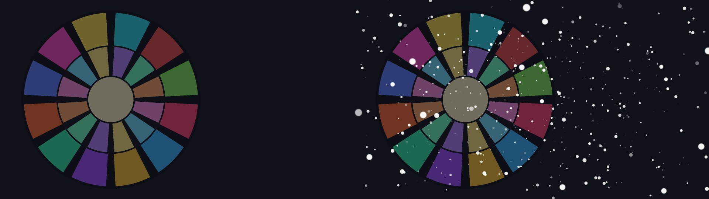

# Snow3D / 雪（3D） / 3D Snow

`雪（3D）.obj2 v1.23` &nbsp;|&nbsp; `AviUtl ExEdit2 v2.1.15+` &nbsp;|&nbsp; `MIT License` &nbsp;|&nbsp; 无插件依赖（纯脚本）

[English](docs/README_en.md) | [日本語](docs/README_ja.md)



> ❄️ **AviUtl ExEdit2 用「真·3D」雪粒子系统自定义物件** —— 数千片雪花在真实三维空间中飘舞，被建筑物与角色正确遮挡。

## 1. 项目简介与核心特性

在 AviUtl2 的 3D 摄像机空间中模拟**真实三维的降雪**：

- **真 3D 粒子**：最多 4000 片雪花拥有独立的三维位置、速度、重力、风场与摆动（sway），绕镜头旋转时透视关系完全正确——不是贴在屏幕上的平面粒子。
- **硬件深度遮挡**：粒子作为 3D 几何绘制，与场景中的人物、建筑自然产生前后遮挡；软边缘（`エッジのぼかし`）与大小分散让近景雪花呈现自然景深虚化。
- **智能发生区域**：发生箱可跟随摄像机（`カメラに追従`）或固定于世界坐标（`世界座標に固定`），自动包裹画面所需范围并把墙壁推出画面外（`壁を画面の外へ`），屏幕内永远有雪、屏幕外不浪费粒子。
- **寿命与淡入淡出**：粒子按生存时间自然出现/消逝，避免「齐刷刷下落」的机械感。
- **纯脚本零依赖**：不依赖任何插件，拖入即用。

## 2. 使用环境与系统要求

| 项目 | 要求 |
|---|---|
| 本体 | AviUtl ExEdit2 `v2.1.15` 及以上（ＫＥＮくん官方，需自行安装） |
| 系统 | Windows（Direct3D 11） |
| 其它 | 无需任何插件 |

## 3. 安装方法（支持 `.au2pkg.zip` 拖入即装）

1. 下载 **`Snow3D-v1.23.au2pkg.zip`**；
2. 把 zip **直接拖进 AviUtl2 窗口**即可完成安装；
3. 手动安装：将 `Script/雪（3D）.obj2` 与 `Language/*.aul2` 分别放入 `C:\ProgramData\aviutl2\Script\` 与 `C:\ProgramData\aviutl2\Language\`。

## 4. 快速上手

1. 任意图层添加「**雪（3D）**」自定义物件（通常放在人物之后、背景之前）；
2. 默认参数即为常见的自然降雪；想要暴雪就提高「粒子数」与「粒径」，想要细雪就降低「粒径」并提高「エッジのぼかし」；
3. 场景有「カメラ制御」时，开启「カメラに追従」可让雪随镜头移动；固定机位则用「世界座標に固定」。

## 5. 参数详细说明（点击展开折叠面板）

<details>
<summary><b>参数一览（默认值）</b></summary>

| 分组 | 参数 | 范围（默认） | 说明 |
|---|---|---|---|
| 雪 | 粒子数 | 1–4000（400） | 同屏雪花数量 |
| 雪 | 粒径 | 0.1–400（8） | 雪花基础尺寸 |
| 雪 | 大きさのばらつき | 0–100（50） | 尺寸分散程度 |
| 雪 | エッジのぼかし | 0–100（100） | 软边缘（近景景深感） |
| 雪 | 雪の色 | —（#ffffff） | 雪花颜色 |
| 运动 | 初速X/Y/Z | ±3000（0/200/0） | 初始速度 |
| 运动 | 初速のばらつき | 0–85（25） | 初速分散 |
| 运动 | 重力 | ±5000（400） | 重力加速度 |
| 运动 | 風X/Y/Z | ±3000（0） | 风场 |
| 运动 | 揺れ幅 / 揺れ速さ | 0–500（30）/ 0–20（2） | 摆动幅度与频率 |
| 运动 | 回転速度 | ±720°/s（90） | 旋转速度 |
| 区域 | 領域の余裕 | 0–200（20） | 发生箱外扩余量 |
| 区域 | 幅(X) / 高さ(Y) / 奥行き(Z) | 10–20000（1920/1080/1500） | 发生箱尺寸 |
| 区域 | 中心X/Y/Z | ±20000（0） | 发生箱中心 |
| 区域 | 画面サイズに同期 / 壁を画面の外へ | false/false | 自适应画面 / 推出画面外 |
| 区域 | カメラに追従 / 世界座標に固定 | true/true | 相机跟随 / 世界固定 |
| 区域 | 折り返しのぼかし / 領域の枠を表示 | 0–100（40）/ false | 边界折返软化 / 调试边框 |
| 寿命 | 移動時間から自動 | true | 按飞行距离自动估算寿命 |
| 寿命 | 生存時間 | 0.1–60s（6） | 粒子寿命 |
| 寿命 | 出現フェード / 消滅フェード | 0–50（10）/ 0–100（30） | 出现/消逝淡入淡出 |

</details>

## 6. 兼容性说明

- 本脚本 100% 基于官方 Lua API（`obj.drawpoly` 等），不访问宿主内部结构、不依赖内存探针——**官方更新不会导致失效**。
- 与《体积光（3D）》《VolumetricFog3D》可在同一场景叠加使用（体积光 v3.07+ 会自动把雪图层排除出遮挡候选）。

## 体积光联动（v1.23）

与 [VolumetricLight3D v3.16+](https://github.com/CylnaNangong/AviUtl2_VolumetricLight3D) 配合，在同一场景中通过官方 `global` 表共享 `VL3DLF v3` 光场：雪花进入光束时受光染色，进入投影阴影或前景遮罩后停止受光。支持多光源、彩色光、对象三维变换及编辑相机同步。

展开「体積光連動」分组：

| 参数 | 范围（默认） | 用途 |
|---|---|---|
| 体積光に照らされる | true | 启用联动 |
| 受光の強さ | 0–300（120） | 受光强度 |
| 光色の染まり | 0–100（85） | 光色染色比例 |
| 光束外・影の減光 | 0–100（30） | 光束外与阴影压暗 |
| 発光の広がり | 100–280（135） | 光晕范围 |

无活动光源时保持原有降雪路径，单独使用仍不需要插件。日志状态：`OFF` 为关闭，`WAIT` 为尚无光场发布，`IDLE` 为光场撤回或过期，`ON(N:M)` 为连接 N 个光源、照亮 M 个粒子。

## 7. 未来发展方向（Roadmap）

- 雪花形状自定义（六角板/枝晶）、堆积与融化表现。

## 8. 问题反馈（Bug 报告途径）

- **首选 [GitHub Issues](./issues)（最推荐！）**：请附上脚本版本（「ログに出力」开启后见日志 `雪（3D）v1.23 ...`）、AviUtl ExEdit2 版本、复现步骤与截图。
- **Discord 社区**：加入日文 AviUtl2 情报共享社区 **「AviUtl2の情報が知りたいだろって‼」**（[点击加入](https://discord.gg/8qzmGY5NgQ)），找 **南宫若馨Cylna**（`@nangongerregtcylna`，作者本人）直接反馈～

## 9. 作者、致谢与开源许可

- **作者**：[南宫若馨Cylna](https://github.com/CylnaNangong)（[Bilibili](https://space.bilibili.com/81615223) ｜ [YouTube](https://www.youtube.com/@CylnaNangong) ｜ [X](https://x.com/CylnaNangong) ｜ [Twitch](https://www.twitch.tv/cylna_nangong)）＆ **Arena.ai Agent**
- **致谢**：ＫＥＮくん（AviUtl ExEdit2 本体与 Plugin SDK）；AviUtl2 社区（[nctype](https://github.com/nctype)、[HexBrowns](https://github.com/HexBrowns)、[IZUisMe](https://github.com/IZUisMe) 等的开发分享）；ChatGPT / Gemini / Microsoft Copilot。
- **许可**：MIT License（见 [LICENSE](LICENSE) 与 [THIRD_PARTY_NOTICES.md](THIRD_PARTY_NOTICES.md)）。AviUtl ExEdit2 是 ＫＥＮくん氏的软件，本项目与其相互独立。

## 10. 构建与自动发布

```bash
python3 -m unittest discover -s tests -v
python3 packaging/build_au2pkg.py --out-dir dist
```

生成 `dist/Snow3D-v1.23.au2pkg.zip`（脚本、四份语言包及安装说明，UTF-8 / CRLF）。

工作流见 [release.yml](.github/workflows/release.yml)：

- **推送版本标签 `v*`**：检出标签对应的代码，测试、打包，自动创建 Release（如尚不存在）并上传安装包。
- **发布 GitHub Release**：自动为该 Release 的标签打包并上传安装包。
- **Actions → release → Run workflow**：输入已有标签补传；留空使用最新已发布 Release。手动执行不会创建 Release，需先建立对应 Release。
- 发布前同步 `packaging/build_au2pkg.py` 的 `VERSION`、脚本版本、`package.ini` / `package.txt` 和文档；标签必须与包版本相同（例如 `v1.23`），否则工作流失败而不上传。
- 使用内置 `GITHUB_TOKEN`（`contents: write`），无需额外密钥；仓库需允许 GitHub Actions 运行。安装包也保留为 workflow artifact，摘要附 SHA-256。重复运行会覆盖同名附件。

本次移植来源：[VolumetricLight3D PR #15](https://github.com/CylnaNangong/AviUtl2_VolumetricLight3D/pull/15)，固定提交 `c19c9f030bc325dbe361716c2663a197e8261f4e` 的 `integrations/snow3d/`。脚本、语言包、打包配置及中日更新历史保持上游内容；没有引入体积光仓库的插件或大型沙箱资源。
