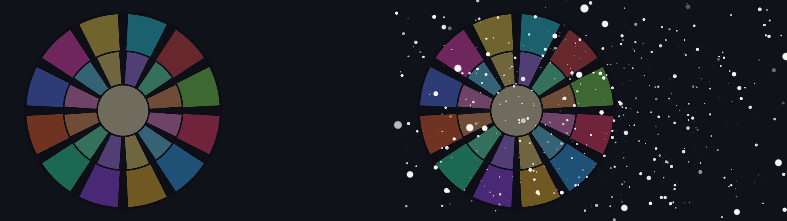

# Snow3D / 3D Snow / 雪（3D）

`雪（3D）.obj2 v1.22` &nbsp;|&nbsp; `AviUtl ExEdit2 v2.1.15+` &nbsp;|&nbsp; `MIT License` &nbsp;|&nbsp; No plugin required (pure script)

[简体中文](../README.md) | [日本語](README_ja.md)

> ❄️ **THE REAL 3D snow particle system custom object for AviUtl ExEdit2** — thousands of snowflakes drifting through true 3D space, correctly occluded by buildings and characters.

## 1. Overview & Key Features

Simulates **true three-dimensional snowfall** inside AviUtl2's 3D camera space:

- **True 3D particles**: up to 4000 snowflakes each carry independent 3D position, velocity, gravity, wind and sway — orbit the camera and the perspective stays physically correct. Not a screen-space decal fake.
- **Hardware depth occlusion**: particles draw as 3D geometry, naturally occluded by characters and props; soft edges plus size variance give natural depth-of-field on near flakes.
- **Smart spawn volume**: the spawn box follows the camera (`カメラに追従`) or locks to world coordinates (`世界座標に固定`), auto-wrapping the visible frustum and pushing walls off-screen (`壁を画面の外へ`) — always snow on screen, zero particles wasted outside.
- **Lifetime & fades**: particles appear/vanish over their lifetime, eliminating the mechanical "synchronized drop".
- **Pure script, zero dependencies**: no plugins needed — drag and drop.

## 2. System Requirements

| Item | Requirement |
|---|---|
| Host | AviUtl ExEdit2 `v2.1.15` or newer (by KEN-kun; install separately) |
| OS | Windows (Direct3D 11) |
| Others | No plugin required |

## 3. Installation (`.au2pkg.zip` Drag-and-Drop Supported)

1. Download **`Snow3D-v1.22.au2pkg.zip`**;
2. **Drag the zip onto the AviUtl2 window** — done;
3. Manual: place `Script/雪（3D）.obj2` and `Language/*.aul2` into `C:\ProgramData\aviutl2\Script\` and `C:\ProgramData\aviutl2\Language\`.

## 4. Quick Start

1. Add the **雪（3D）** custom object on any layer (behind subjects, in front of backgrounds);
2. Defaults give natural snowfall; raise 「粒子数 / 粒径」 for a blizzard, lower 粒径 and raise 「エッジのぼかし」 for fine drifty snow;
3. With a Camera Control present enable 「カメラに追従」; for locked-off shots use 「世界座標に固定」.

## 5. Complete Parameter Reference (Click to Expand)

<b>Parameter list (defaults)</b>

| Group | Parameter | Range (default) | Description |
|---|---|---|---|
| Snow | 粒子数 Count | 1–4000 (400) | On-screen flakes |
| Snow | 粒径 / 大きさのばらつき | 0.1–400 (8) / 0–100 (50) | Size & variance |
| Snow | エッジのぼかし / 雪の色 | 0–100 (0) / #ffffff | Soft edge & color |
| Motion | 初速XYZ / 初速のばらつき | ±3000 (0/200/0) / 0–85 (25) | Initial velocity |
| Motion | 重力 / 風XYZ | ±5000 (400) / ±3000 | Forces |
| Motion | 揺れ幅 / 揺れ速さ / 回転速度 | 30 / 2 / 90 | Sway & spin |
| Area | W(X)/H(Y)/D(Z) ・ center XYZ | 1920/1080/1500 ・ 0 | Spawn box |
| Area | カメラに追従 / 世界座標に固定 / 壁を画面の外へ | true/true/false | Follow & placement |
| Area | 折り返しのぼかし / 枠表示 | 40 / false | Boundary & debug |
| Life | 生存時間 / 出現・消滅フェード | 6s / 10 / 30 | Lifetime & fades |

## 6. Compatibility Notes

- 100% built on official Lua APIs (`obj.drawpoly` etc.) with zero host-internal access or memory probes — **official updates cannot break it**.
- Stacks freely with `VolumetricLight3D` and `VolumetricFog3D` in the same scene (Volumetric Light v3.07+ auto-excludes snow layers from occluder candidates).

## 7. Future Roadmap

- Cross-script 3D optics with sister projects [`VolumetricLight3D`](https://github.com/CylnaNangong/VolumetricLight3D) and [`VolumetricFog3D`](https://github.com/CylnaNangong/VolumetricFog3D) via `VL3DBridge`: **snowflakes drifting through light shafts get tinted and highlighted in real time**.
- Custom flake shapes (hex plates / dendrites), accumulation & melting.

## 8. Reporting Bugs

- **[GitHub Issues](../../issues) is the best channel!** Please include the script version (enable 「ログに出力」 to see `雪（3D）v1.22 ...`), your AviUtl ExEdit2 version, reproduction steps, and screenshots.
- **Discord**: join the Japanese AviUtl2 community **「AviUtl2の情報が知りたいだろって‼」** ([invite](https://discord.gg/8qzmGY5NgQ)) and ping **南宫若馨Cylna** (`@nangongerregtcylna`, the author)!

## 9. Authors, Acknowledgements & License

- **Authors**: [Cylna Nangong](https://github.com/CylnaNangong) & **Arena.ai Agent**
- **Acknowledgements**: KEN-kun (AviUtl ExEdit2 & Plugin SDK); the AviUtl2 community ([nctype](https://github.com/nctype), [HexBrowns](https://github.com/HexBrowns), [IZUisMe](https://github.com/IZUisMe), …); ChatGPT / Gemini / Microsoft Copilot.
- **License**: MIT (see [LICENSE](../LICENSE) & [THIRD_PARTY_NOTICES.md](../THIRD_PARTY_NOTICES.md)). AviUtl ExEdit2 is KEN-kun's software; this project is independent of it.
